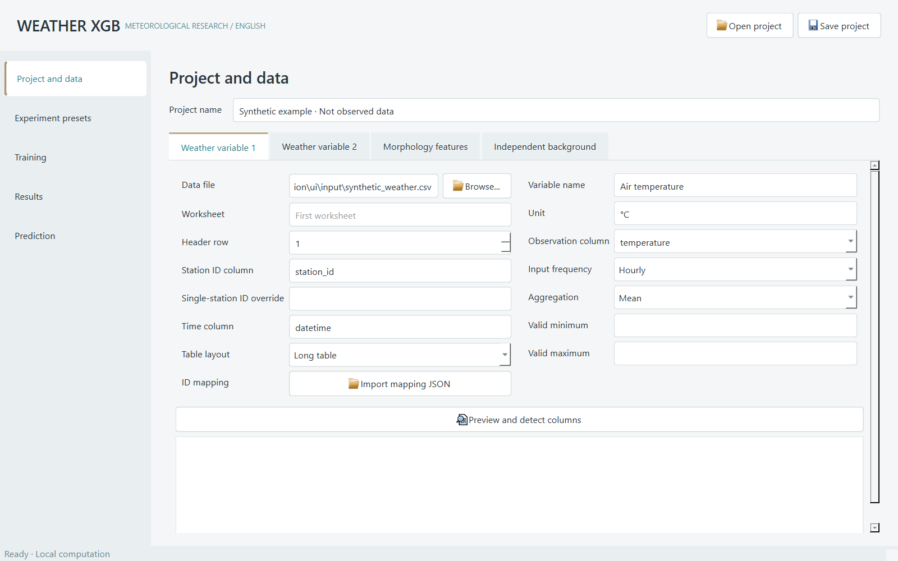
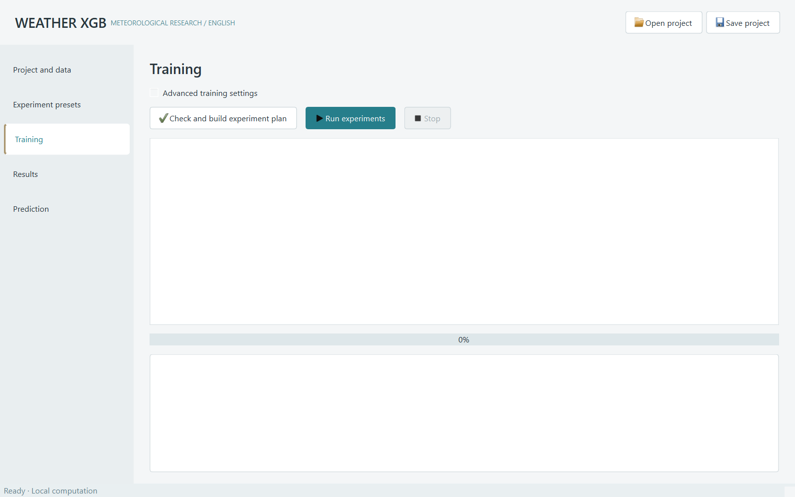

# Weather XGB — English desktop workbench

Weather XGB is a local desktop application for meteorological XGBoost experiments with station observations and urban morphology features. This edition provides an English interface, English diagnostics and experiment reports, an English synthetic example, and a Windows portable build.

The existing research workflow is retained: two independently fitted weather targets, multiple morphology scales, calendar-aware aggregation, nested station or time validation, independent background stations, native TreeSHAP contributions, and reloadable model bundles.



## Start the application

### Windows portable release

Download `WeatherXGB-English-1.1.0-windows-x64.zip` from this repository's **Releases** page and extract it. Open `WeatherXGB-English/WeatherXGB-English.exe`. Keep the entire folder, including `_internal`, together. Python does not need to be installed separately for this build.

To try the bundled example, double-click `Open synthetic example.bat` inside that folder. Alternatively, use **Open project** to select `examples/example_project.json`. The example is synthetic and must not be interpreted as research observations. Copy it to a writable folder if the application is installed in a protected location.

### Python source

The verified environment is Windows x64 with Python 3.13. Python 3.11 or newer is needed for the source syntax; other platforms and versions have not been verified for this release.

From the repository root:

```powershell
python -m venv .venv
.venv\Scripts\python.exe -m pip install -r requirements.txt
.venv\Scripts\python.exe -m weather_xgb
```

Open an example directly:

```powershell
.venv\Scripts\python.exe -m weather_xgb --project examples/example_project.json
```

`start_english.bat` launches an existing portable build, the repository's `.venv`, or an installed `pythonw`, in that order. It does not install dependencies. `requirements.txt` pins the direct dependencies; `requirements-lock.txt` records the Windows build environment, including transitive and packaging dependencies.

## First experiment

1. In **Project and data**, configure two weather variables. Select a file, worksheet, one-based header row, station ID column, time column, observation column, variable name, unit, frequency and aggregation. Both targets can read the same file. Use **Preview and detect columns** to inspect the input. Existing Chinese field names remain supported; source columns and user-defined labels are preserved exactly.
2. Open the **Morphology features** tab. **Add scale**, select a station-level morphology table and **Read features**. Mark each feature as **Numeric**, **Categorical**, or **Ignore**. A scale can be a radius such as `250` or a descriptive identifier. Station names should not be numeric predictors.
3. In **Experiment presets**, select the time grain, research task, feature set and minimum coverage. Each preset represents one combination. Use one-step forecasting for a single station; morphology association needs variation across multiple stations.
4. In **Training**, click **Check and build experiment plan**. Inspect availability, samples, stations, models, expected fits and diagnostic messages. Open **Advanced training settings** to change folds, threads, parameter candidates or the output directory.
5. Click **Run experiments**. The worker process keeps the interface responsive. **Stop** requests cancellation at the next checkpoint after the current fit.
6. In **Results**, inspect the experiment summary, charts, fold metrics and research notes. Select an experiment to populate its final model in **Prediction**. Predictions can be exported with **Export CSV**.



## Input contracts

Weather long tables contain a station ID, local timestamp and target column. Morphology tables contain one row per station with the selected features. CSV (UTF-8 or GB18030), XLSX, XLSM and XLS are supported. Station-row/date-column wide weather tables are also supported; their date headers use forms such as `2025-01-01`.

If a file represents one station without a station ID column, provide a **Single-station ID override** and use the same ID in the morphology table. Optional mapping JSON, for example `{"local01":"S01"}`, maps source IDs to canonical IDs. Stations are matched by ID, never by row order.

Use a consistent station-local time basis. Hourly timestamps must be on the hour, daily timestamps at midnight and monthly timestamps at the start of the month. Duplicate station/time records must be handled explicitly before import. The application does not infer mixed time zones, upsample observations, convert units or rewrite source files.

The targets are cleaned and trained independently. Missing numeric morphology values remain missing. Categorical mappings are fitted inside each training fold; unseen categories are treated as missing. A target's simultaneous observation is not automatically used to predict the other target.

Mean aggregation is typically appropriate for temperature, humidity and wind speed; interval precipitation totals may use sum. Convert cumulative counter readings to interval increments before importing them. All-missing precipitation is not replaced with zero. The user must check units and aggregation definitions.

Coverage uses a complete calendar window, including at the edges of the input period. At 80% coverage, a non-leap February with hourly data requires at least `28 × 24 × 0.8` valid observations. Each target exports coverage details and excluded records.

## Presets and validation

| Option | Meaning |
| --- | --- |
| Hourly / Daily / Monthly | Station observations aggregated into complete calendar windows; different years remain separate. |
| Seasonal | Three-month windows, starting in December by default; the start month is configurable. |
| Day/night | Separate daytime and nighttime models. Default daytime is 06:00–18:00; cross-midnight windows are supported. |
| Month-balanced | Equal weighting of monthly aggregates, with one result per station; only stations meeting coverage for every study month are included. |
| Independent background | Explicit independent reference station IDs, or a separate background file for each target. Reference stations must not overlap any study morphology table. |
| Morphology association | Outer held-out station folds with inner station folds for parameter selection. |
| One-step-ahead forecast | Expanding time splits, historical target lags and calendar features; predictions are evaluated as rolling one-step forecasts. |

Association defaults to five outer and three inner folds. Forecasting defaults to three outer and two inner time splits. Presets with insufficient data are marked unavailable during preflight; they are not silently changed to random splits. Valid presets can still run, and skipped presets are recorded.

Candidate forecast lags are 1/24/168 hours, 1/7/14 days, or 1/3/12 months. Available time length determines which windows are used. Missing periods are represented on a regular grid, so the preceding record does not substitute for a missing hour. Rolling one-step evaluation uses actual past observations available at each step; it is not recursive multi-step forecasting.

All scales for a given target, preset and day/night segment share the samples and folds. Interpret metrics separately for different targets, units and time grains. Negative R² is retained; R² is undefined for a constant target. Station validation does not constitute spatial block validation. Morphology associations and TreeSHAP do not establish causality.

`metrics.csv` contains training, outer-test and baseline metrics. Forecasts include a persistence baseline. Background experiments include a background-only model baseline. TreeSHAP uses XGBoost's native exact tree contribution interface, with at most 300 records per outer fold; a separate `shap` installation is unnecessary.

## Prediction and saved outputs

Choose an experiment's `final` directory containing `model.ubj` and `manifest.json`. Predict with the current project mapping or a separate current-format project JSON. Target names, units, input frequency and aggregation must match the model, and morphology features and scale identifiers must cover its inputs. This also applies to models from the original edition: use their original target names when loading them.

Association prediction can use a long table containing station IDs and requested times without observed targets. Background models still require independent background observations. A day/night model predicts only its own segment. Forecast models require observed history and produce the next time period for each matching station. Missing required lags are reported; future observations are not fabricated recursively.

Each run creates a separate output directory:

| File or directory | Contents |
| --- | --- |
| `project.json`, `audit.json`, `station_matching.csv` | Configuration, source fingerprints, preflight report and station matching. |
| `status.json` | `running`, `completed`, `completed_with_skips`, `cancelled` or `failed`. |
| `summary.csv`, `review.md` | Experiment summaries and English interpretation notes. |
| Experiment directories | Prepared samples, coverage, exclusions, predictions, metrics, parameter trials, importance, TreeSHAP, PNG/SVG charts and model bundles. |
| `fold_N` | Model trained for that outer fold. |
| `final` | Model retuned and fitted on all valid training data; its training score does not replace out-of-fold evaluation. |

Cancelled or failed runs retain completed folds. Resume-from-checkpoint is not implemented; a new run creates a new directory. Model bundles use native XGBoost and JSON, without pickle deserialization. Legacy project JSON and historical summaries can be opened; converted mappings require review.

New projects default to `Documents/WeatherXGB`. Example JSON paths are resolved relative to the JSON file, and example output goes to a sibling `runs` directory.

## Development and reproducible checks

Run these commands from the repository root to ensure this package is imported:

```powershell
.venv\Scripts\python.exe -m unittest discover -s tests -v
.venv\Scripts\python.exe -m weather_xgb.verification ui verification/ui
.venv\Scripts\python.exe -m weather_xgb.verification runtime verification/source_runtime
.venv\Scripts\python.exe -m PyInstaller --noconfirm --distpath release --workpath build WeatherXGB-English.spec
.venv\Scripts\python.exe -m weather_xgb.package_release
release\WeatherXGB-English\WeatherXGB-English.exe --verify-runtime verification/portable_runtime
```

The runtime check generates synthetic input, starts an actual spawned training worker, exports charts, reloads a saved model and captures the English results page. It never accesses the original research data. See [the validation record](docs/VALIDATION.md) for the checked environment and limits. A Windows CI workflow also runs the unit and UI integration tests.

The public repository contains source code, documentation, tests and synthetic data. Generated runs, model files, virtual environments, machine-specific paths and research observations are excluded. Dependency notices are included in the portable build; see [third-party notices](THIRD_PARTY_NOTICES.md).
