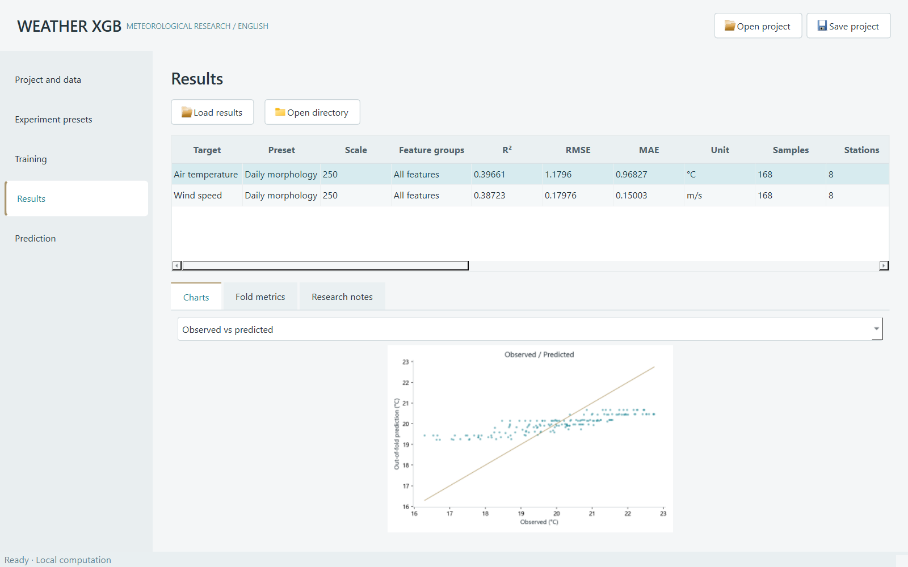

# English release validation

Release: **1.1.0 English**. Validation date: **11 October 2026**.

This record covers the English edition. Checks use generated synthetic data and never read the original research observations.

## Verified environment

- Windows x64, Python 3.13.9.
- PySide6 6.9.2, XGBoost 3.4.1, PyInstaller 6.20.0.
- Direct dependencies pinned in `requirements.txt`; the build environment is recorded in `requirements-lock.txt`.

## Source and interface checks

The 24 inherited unit and native-widget integration tests passed. Coverage includes calendar aggregation, leap-year and partial-month coverage, missing-target independence, duplicate and upsampling rejection, cross-midnight periods, forecast lags without future leakage, station and time splits, training-only category encoding, independent background stations, month balancing, nested parameter selection, cancellation, chart/model export, model reloading, next-period inference, project path resolution, unlabelled association inference and asynchronous desktop prediction.

The five main pages were captured at 1280×800 and 1920×1080. The display scale was 125%. The configuration survived a UI roundtrip without changes. The label scan checked 235 built-in labels, buttons, navigation items and combo options and found no Chinese UI labels. Source-column aliases and user-defined labels are preserved in their original language. Advanced settings and the morphology dialog were also visually reviewed.

The source runtime check launched an actual spawned worker, completed two synthetic daily association experiments, exported TreeSHAP SVG charts, reloaded a final model and produced 168 predictions. The worker exited with code 0. Experiment interpretation notes were English.

The original version-1 Chinese example project was also loaded without changing its configuration or target names and generated six valid experiment jobs. An AST comparison verified that the structure of the configuration, data processing, engine, synthetic generator and plotting code was retained after translating text. The public source scan found no credentials or developer-machine paths.

## Windows portable check

The PyInstaller build completed successfully. The portable executable was then checked with `--verify-runtime`, using the packaged interpreter, spawned worker, chart exporters and model reloading. The check completed two experiments, generated 168 predictions and returned worker exit code 0. A repeat check after extracting the downloadable ZIP also passed.

The build specification explicitly includes `ffi.dll`, `libmpdec-4.dll` and `sqlite3.dll` when the build interpreter is based on conda, so those CPython dependencies do not rely on the developer's PATH.

The portable folder includes the bundled example, English guide, pinned dependency records and collected dependency license notices. Keep `_internal` together with the executable.

## Scope and limits

These checks establish operation in the development environment and from the extracted release archive. They are not a test on a separate clean Windows virtual machine. Other operating systems, a machine without any previously installed Python, and other display scales have not been independently verified for this release. Runtime self-verification is available on the recipient's machine with `WeatherXGB-English.exe --verify-runtime <writable-output-folder>`.

Synthetic experiment metrics validate operation and are not scientific results. Station-based validation is not spatial block validation; TreeSHAP and associations do not establish causality. Final-model training scores do not replace outer out-of-fold metrics.
